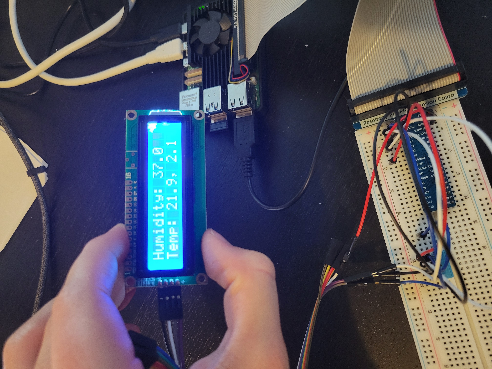

# Weather-Station

One of my first projects outside of studies where I combined both hardware and software. The projects was quite simple where I combined a temperature and humidity sensor with a LCD display. I also added a api call to get the temperature outside.

The codes for the DHT and LCD were provided by the manufacturer.

The result and the setup are shown in the image below.

